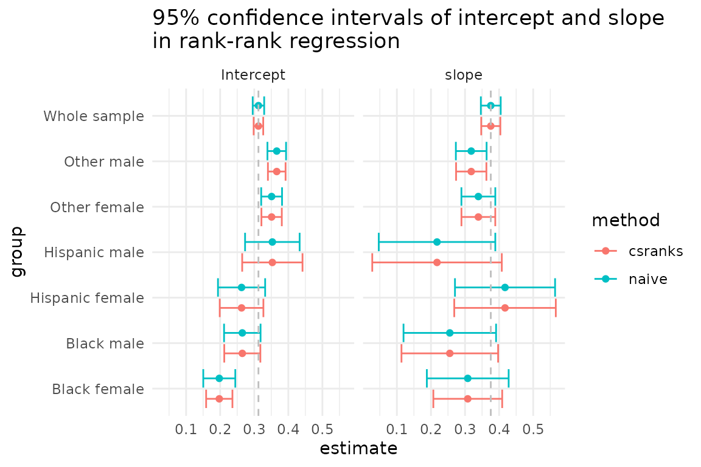

# Inference for Rank-Rank Regressions

The following example illustrates how the `csranks` package can be used
for estimation and inference in rank-rank regressions. These are
commonly used for studying intergenerational mobility.

## Example: Intergenerational Mobility

In this example, we want to intergenerational income mobility by
estimating and performing inference on the rank correlation between
parents and their children’s incomes. The `csranks` package contains an
artificial dataset with data on children’s and parents’ household
incomes, the child’s gender and race (`black`, `hisp` or `neither`).

First, load the package `csranks`. Second, load the data and take a
quick look at it:

``` r

library(csranks)
data(parent_child_income)
head(parent_child_income)
#>    c_faminc  p_faminc gender    race
#> 1  78771.72 77127.484 female neither
#> 2  79268.33 62723.303 female neither
#> 3  45405.98 65751.340   male neither
#> 4  81951.64 58723.050   male neither
#> 5  88350.33  6381.047   male neither
#> 6 161331.33 40325.466 female neither
```

### Rank-rank regression

In economics, it is common to estimate measures of mobility by running
rank-rank regressions. For instance, the rank correlation between
parents’ and children’s incomes can be estimated by running a regression
of a child’s income rank on the parent’s income rank:

``` r

lmr_model <- lmranks(r(c_faminc) ~ r(p_faminc), data = parent_child_income)
summary(lmr_model)
#> 
#> Call:
#> lmranks(formula = r(c_faminc) ~ r(p_faminc), data = parent_child_income)
#> 
#> Residuals:
#>      Min       1Q   Median       3Q      Max 
#> -0.65601 -0.21986 -0.00376  0.22088  0.66495 
#> 
#> Coefficients:
#>             Estimate Std. Error z value Pr(>|z|)    
#> (Intercept) 0.312311   0.007161   43.61   <2e-16 ***
#> r(p_faminc) 0.375538   0.014319   26.23   <2e-16 ***
#> ---
#> Signif. codes:  0 '***' 0.001 '**' 0.01 '*' 0.05 '.' 0.1 ' ' 1
```

This regression specification takes each child’s income (`c_faminc`),
computes its rank among all children’s incomes, then takes each parent’s
income (`p_faminc`) and computes its rank among all parents’ incomes.
Then the child’s rank is regressed on the parent’s rank using OLS. The
`lmranks` function computes standard errors, t-values and p-values
according to the asymptotic theory developed in Chetverikov and Wilhelm
(2023).

A naive approach, which **does not** lead to valid inference, would
compute the children’s and parents’ ranks first and the run a standard
OLS regression afterwards:

``` r

c_faminc_rank <- frank(parent_child_income$c_faminc, omega = 1, increasing = TRUE)
p_faminc_rank <- frank(parent_child_income$p_faminc, omega = 1, increasing = TRUE)
lm_model <- lm(c_faminc_rank ~ p_faminc_rank)
summary(lm_model)
#> 
#> Call:
#> lm(formula = c_faminc_rank ~ p_faminc_rank)
#> 
#> Residuals:
#>      Min       1Q   Median       3Q      Max 
#> -0.65601 -0.21986 -0.00376  0.22088  0.66495 
#> 
#> Coefficients:
#>               Estimate Std. Error t value Pr(>|t|)    
#> (Intercept)   0.312311   0.008579   36.41   <2e-16 ***
#> p_faminc_rank 0.375538   0.014856   25.28   <2e-16 ***
#> ---
#> Signif. codes:  0 '***' 0.001 '**' 0.01 '*' 0.05 '.' 0.1 ' ' 1
#> 
#> Residual standard error: 0.2676 on 3892 degrees of freedom
#> Multiple R-squared:  0.141,  Adjusted R-squared:  0.1408 
#> F-statistic:   639 on 1 and 3892 DF,  p-value: < 2.2e-16
```

Notice that the point estimates of the intercept and slope are the same
as those of the `lmranks` function. However, the standard errors,
t-values and p-values differ. This is because the usual OLS formulas for
standard errors do not take into account the estimation uncertainty in
the ranks.

One can also run the rank-rank regression with additional covariates,
e.g.:

``` r

lmr_model_cov <- lmranks(r(c_faminc) ~ r(p_faminc) + gender + race, data = parent_child_income)
summary(lmr_model_cov)
#> 
#> Call:
#> lmranks(formula = r(c_faminc) ~ r(p_faminc) + gender + race, 
#>     data = parent_child_income)
#> 
#> Residuals:
#>      Min       1Q   Median       3Q      Max 
#> -0.66140 -0.20654 -0.00343  0.21421  0.72917 
#> 
#> Coefficients:
#>              Estimate Std. Error z value Pr(>|z|)    
#> (Intercept)  0.299823   0.018155  16.514  < 2e-16 ***
#> r(p_faminc)  0.323785   0.015123  21.411  < 2e-16 ***
#> gendermale   0.010862   0.008484   1.280  0.20042    
#> raceblack   -0.088215   0.020910  -4.219 2.46e-05 ***
#> raceneither  0.055726   0.018781   2.967  0.00301 ** 
#> ---
#> Signif. codes:  0 '***' 0.001 '**' 0.01 '*' 0.05 '.' 0.1 ' ' 1
```

### Grouped rank-rank regression

In some economic applications, it is desired to run rank-rank
regressions separately in subgroups of the population, but compute the
ranks in the whole population. For instance, we might want to estimate
rank-rank regression slopes as measures of intergenerational mobility
separately for males and females, but the ranking of children’s incomes
is formed among all children (rather than form separate rankings for
males and females).

Such regressions can easily be run using the `lmranks` function and
interaction notation:

``` r

grouped_lmr_model_simple <- lmranks(r(c_faminc) ~ r(p_faminc_rank):gender,
  data = parent_child_income
)
summary(grouped_lmr_model_simple)
#> 
#> Call:
#> lmranks(formula = r(c_faminc) ~ r(p_faminc_rank):gender, data = parent_child_income)
#> 
#> Residuals:
#>      Min       1Q   Median       3Q      Max 
#> -0.65016 -0.21977 -0.00308  0.21750  0.68833 
#> 
#> Coefficients:
#>                               Estimate Std. Error z value Pr(>|z|)    
#> genderfemale                   0.28796    0.01119   25.74   <2e-16 ***
#> gendermale                     0.33506    0.01107   30.27   <2e-16 ***
#> r(p_faminc_rank):genderfemale  0.40800    0.02046   19.94   <2e-16 ***
#> r(p_faminc_rank):gendermale    0.34516    0.02044   16.89   <2e-16 ***
#> ---
#> Signif. codes:  0 '***' 0.001 '**' 0.01 '*' 0.05 '.' 0.1 ' ' 1
```

In this example, we have run a separate OLS regression of children’s
ranks on parents’ ranks among the female and male children. However,
incomes of children are ranked among all children and incomes of parents
are ranked among all parents. The standard errors, t-values and p-values
are implemented according to the asymptotic theory developed in
Chetverikov and Wilhelm (2023), where it is shown that the asymptotic
distribution of the estimators now need to not only account for the fact
that ranks are estimated, but also for the fact that estimators are
correlated across gender subgroups because they use the same estimated
ranking.

A naive application of the `lm` function would produce the same point
estimates, but **not** the correct standard errors:

``` r

grouped_lm_model_simple <- lm(c_faminc_rank ~ p_faminc_rank:gender + gender - 1, # group-wise intercept
  data = parent_child_income
)
summary(grouped_lm_model_simple)
#> 
#> Call:
#> lm(formula = c_faminc_rank ~ p_faminc_rank:gender + gender - 
#>     1, data = parent_child_income)
#> 
#> Residuals:
#>      Min       1Q   Median       3Q      Max 
#> -0.65016 -0.21977 -0.00308  0.21750  0.68833 
#> 
#> Coefficients:
#>                            Estimate Std. Error t value Pr(>|t|)    
#> genderfemale                0.28796    0.01233   23.35   <2e-16 ***
#> gendermale                  0.33506    0.01192   28.10   <2e-16 ***
#> p_faminc_rank:genderfemale  0.40800    0.02135   19.11   <2e-16 ***
#> p_faminc_rank:gendermale    0.34516    0.02066   16.71   <2e-16 ***
#> ---
#> Signif. codes:  0 '***' 0.001 '**' 0.01 '*' 0.05 '.' 0.1 ' ' 1
#> 
#> Residual standard error: 0.2674 on 3890 degrees of freedom
#> Multiple R-squared:  0.7858, Adjusted R-squared:  0.7855 
#> F-statistic:  3567 on 4 and 3890 DF,  p-value: < 2.2e-16
```

One can also create more granular subgroups by interacting several
characteristics such as gender and race:

``` r

parent_child_income$subgroup <- interaction(parent_child_income$gender, parent_child_income$race)
grouped_lmr_model <- lmranks(r(c_faminc) ~ r(p_faminc_rank):subgroup,
  data = parent_child_income
)
summary(grouped_lmr_model)
#> 
#> Call:
#> lmranks(formula = r(c_faminc) ~ r(p_faminc_rank):subgroup, data = parent_child_income)
#> 
#> Residuals:
#>      Min       1Q   Median       3Q      Max 
#> -0.65574 -0.20769 -0.00387  0.21297  0.73248 
#> 
#> Coefficients:
#>                                         Estimate Std. Error z value Pr(>|z|)
#> subgroupfemale.hisp                      0.26280    0.03268   8.041 8.94e-16
#> subgroupmale.hisp                        0.35313    0.04516   7.820 5.26e-15
#> subgroupfemale.black                     0.19741    0.01968  10.031  < 2e-16
#> subgroupmale.black                       0.26496    0.02702   9.805  < 2e-16
#> subgroupfemale.neither                   0.35096    0.01525  23.006  < 2e-16
#> subgroupmale.neither                     0.36603    0.01322  27.694  < 2e-16
#> r(p_faminc_rank):subgroupfemale.hisp     0.41733    0.07602   5.490 4.02e-08
#> r(p_faminc_rank):subgroupmale.hisp       0.21780    0.09697   2.246 0.024694
#> r(p_faminc_rank):subgroupfemale.black    0.30798    0.05154   5.976 2.29e-09
#> r(p_faminc_rank):subgroupmale.black      0.25528    0.07234   3.529 0.000417
#> r(p_faminc_rank):subgroupfemale.neither  0.33908    0.02532  13.390  < 2e-16
#> r(p_faminc_rank):subgroupmale.neither    0.31818    0.02270  14.018  < 2e-16
#>                                            
#> subgroupfemale.hisp                     ***
#> subgroupmale.hisp                       ***
#> subgroupfemale.black                    ***
#> subgroupmale.black                      ***
#> subgroupfemale.neither                  ***
#> subgroupmale.neither                    ***
#> r(p_faminc_rank):subgroupfemale.hisp    ***
#> r(p_faminc_rank):subgroupmale.hisp      *  
#> r(p_faminc_rank):subgroupfemale.black   ***
#> r(p_faminc_rank):subgroupmale.black     ***
#> r(p_faminc_rank):subgroupfemale.neither ***
#> r(p_faminc_rank):subgroupmale.neither   ***
#> ---
#> Signif. codes:  0 '***' 0.001 '**' 0.01 '*' 0.05 '.' 0.1 ' ' 1
```

Let’s compare the confidence intervals for regression coefficients
produced by `lmranks` and naive approaches.

``` r

grouped_lm_model <- lm(c_faminc_rank ~ p_faminc_rank:subgroup + subgroup - 1, # group-wise intercept
  data = parent_child_income
)
summary(grouped_lm_model)
#> 
#> Call:
#> lm(formula = c_faminc_rank ~ p_faminc_rank:subgroup + subgroup - 
#>     1, data = parent_child_income)
#> 
#> Residuals:
#>      Min       1Q   Median       3Q      Max 
#> -0.65574 -0.20769 -0.00387  0.21297  0.73248 
#> 
#> Coefficients:
#>                                      Estimate Std. Error t value Pr(>|t|)    
#> subgroupfemale.hisp                   0.26280    0.03531   7.443 1.20e-13 ***
#> subgroupmale.hisp                     0.35313    0.04083   8.649  < 2e-16 ***
#> subgroupfemale.black                  0.19741    0.02397   8.236 2.41e-16 ***
#> subgroupmale.black                    0.26496    0.02731   9.701  < 2e-16 ***
#> subgroupfemale.neither                0.35096    0.01561  22.481  < 2e-16 ***
#> subgroupmale.neither                  0.36603    0.01394  26.265  < 2e-16 ***
#> p_faminc_rank:subgroupfemale.hisp     0.41733    0.07490   5.572 2.69e-08 ***
#> p_faminc_rank:subgroupmale.hisp       0.21780    0.08722   2.497 0.012563 *  
#> p_faminc_rank:subgroupfemale.black    0.30798    0.06121   5.032 5.08e-07 ***
#> p_faminc_rank:subgroupmale.black      0.25528    0.06926   3.686 0.000231 ***
#> p_faminc_rank:subgroupfemale.neither  0.33908    0.02536  13.370  < 2e-16 ***
#> p_faminc_rank:subgroupmale.neither    0.31818    0.02300  13.831  < 2e-16 ***
#> ---
#> Signif. codes:  0 '***' 0.001 '**' 0.01 '*' 0.05 '.' 0.1 ' ' 1
#> 
#> Residual standard error: 0.2633 on 3882 degrees of freedom
#> Multiple R-squared:  0.7927, Adjusted R-squared:  0.792 
#> F-statistic:  1237 on 12 and 3882 DF,  p-value: < 2.2e-16
```

``` r

library(ggplot2)
theme_set(theme_minimal())
ci_data <- data.frame(
  estimate = coef(lmr_model),
  parameter = c("Intercept", "slope"),
  group = "Whole sample",
  method = "csranks",
  lower = confint(lmr_model)[, 1],
  upper = confint(lmr_model)[, 2]
)

ci_data <- rbind(ci_data, data.frame(
  estimate = coef(grouped_lmr_model),
  parameter = rep(c("Intercept", "slope"), each = 6),
  group = rep(c(
    "Hispanic female", "Hispanic male", "Black female", "Black male",
    "Other female", "Other male"
  ), times = 2),
  method = "csranks",
  lower = confint(grouped_lmr_model)[, 1],
  upper = confint(grouped_lmr_model)[, 2]
))

ci_data <- rbind(ci_data, data.frame(
  estimate = coef(lm_model),
  parameter = c("Intercept", "slope"),
  group = "Whole sample",
  method = "naive",
  lower = confint(lm_model)[, 1],
  upper = confint(lm_model)[, 2]
))

ci_data <- rbind(ci_data, data.frame(
  estimate = coef(grouped_lm_model),
  parameter = rep(c("Intercept", "slope"), each = 6),
  group = rep(c(
    "Hispanic female", "Hispanic male", "Black female", "Black male",
    "Other female", "Other male"
  ), times = 2),
  method = "naive",
  lower = confint(grouped_lm_model)[, 1],
  upper = confint(grouped_lm_model)[, 2]
))

ggplot(ci_data, aes(y = estimate, x = group, ymin = lower, ymax = upper, col = method, fill = method)) +
  geom_point(position = position_dodge2(width = 0.9)) +
  geom_errorbar(position = position_dodge2(width = 0.9)) +
  geom_hline(aes(yintercept = estimate),
    data = subset(ci_data, group == "Whole sample"),
    linetype = "dashed",
    col = "gray"
  ) +
  coord_flip() +
  labs(title = "95% confidence intervals of intercept and slope\nin rank-rank regression") +
  facet_wrap(~parameter)
```



The coefficient calculated for the whole sample has a narrow confidence
interval, which is expected. In this example, there are some differences
in the correct (`csranks`) confidence intervals and the incorrect
(`naive`) confidence intervals, but they are rather small. The paper by
Chetverikov and Wilhelm (2023), however, provides empirical examples in
which the differences can be quite large.

## Reference & further reading

[Chetverikov and Wilhelm (2023), “Inference for Rank-Rank Regressions”.
arXiv preprint arXiv:2310.15512](https://arxiv.org/pdf/2310.15512)

Check out the documentation of individual functions at the package’s
[website](https://danielwilhelm.github.io/R-CS-ranks/) and further
examples in the package’s [Github
repository](https://github.com/danielwilhelm/R-CS-ranks/tree/master/examples).
